<div align="center">

# 🌅 Horizonte

**Countdowns con alma de Apple: cuenta los días hacia lo que estás esperando.**

Vacaciones, cumpleaños, lanzamientos, conciertos: crea todos los countdowns que quieras, elige
cómo quieres verlos (números, puntitos, anillos, barras, calendario…) y acomódalos a tu gusto en
un grid tipo bento — todo con microinteracciones y motion design al estilo de iOS.

[](https://react.dev/)
[](https://vitejs.dev/)
[](https://tailwindcss.com/)
[](https://www.framer.com/motion/)
[](https://dndkit.com/)
[](https://lucide.dev/)
[](LICENSE)

</div>

---

## ✨ Qué hace

1. **Hero con lo más importante** — arriba, en grande, aparece el countdown más próximo… o el
   que tú **destaques** con ★. Días, horas, minutos y segundos cambian con la transición de dígitos
   de iOS (`numericText`): el número viejo cae y se desenfoca, el nuevo baja y se enfoca.
2. **7 formas de representar un countdown**, elegibles por countdown y cambiables en vivo:

   | Estilo | Cómo se ve |
   |---|---|
   | **Números** | Dígitos grandes con la transición de iOS |
   | **Puntitos** | Cada punto es un día (o un 1 %); el de hoy late |
   | **Anillos** | Tres anillos tipo Actividad del Apple Watch: total, día y minuto |
   | **Barra** | Barra en degradado que se va llenando, con brillo que la recorre |
   | **Semanas** | Cuadrícula de calendario: cada cuadro es un día, la meta va enmarcada |
   | **Columnas** | Cuatro columnas tipo ecualizador para días, horas, minutos y segundos |
   | **Arco** | Medidor semicircular cuyas marcas se encienden conforme avanza el tiempo |

3. **Grid tipo bento, organizado a tu gusto** — cada tarjeta puede ser **chica**, **mediana**
   (2 de ancho) o **grande** (2×2). Arrástralas con el cursor (o con un toque largo en el
   teléfono) y el resto del grid se reacomoda con animación. El modo **Organizar** hace que las
   tarjetas tiemblen como en la pantalla de inicio de iOS y muestra los controles de tamaño y
   destacado; también puedes **ordenar por fecha** con un toque.
4. **Crear y editar sin fricción** — la ventana emerge desde el botón que la abrió y tiene vista
   previa en vivo con el estilo, color e icono que elijas. **Selectores propios** de fecha
   (calendario con cambio de mes por swipe) y de hora (rueda 3D estilo iOS), más atajos rápidos.
5. **Detalle** — al tocar una tarjeta se expande hasta ocupar la pantalla (shared element
   transition), con el countdown en grande, el progreso, el selector de estilo y las acciones
   Destacar / Editar / Eliminar (con **Deshacer**).
6. **Celebración** — cuando un countdown llega a cero, una ráfaga de confeti en su color.
7. **Se adapta a cualquier pantalla** — del teléfono a un monitor de 27": el grid pasa de 1 a 6
   columnas, en pantallas anchas aparece junto al Hero una columna **Después** con los siguientes
   countdowns, y los números grandes escalan con *container queries* según el espacio real de cada
   tarjeta.
8. **Todo local** — los countdowns, su orden, tamaño y el destacado se guardan en tu navegador
   (`localStorage`); no hay cuentas ni servidor.

## 📸 Capturas

<div align="center">
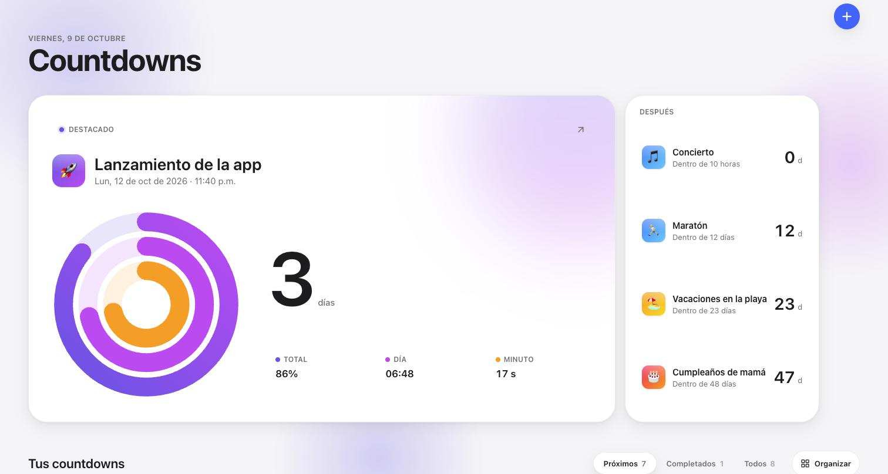<br/><sub>Pantalla ancha: Hero destacado + columna «Después»</sub>
<br/><br/>
<table>
<tr>
<td align="center" width="33%">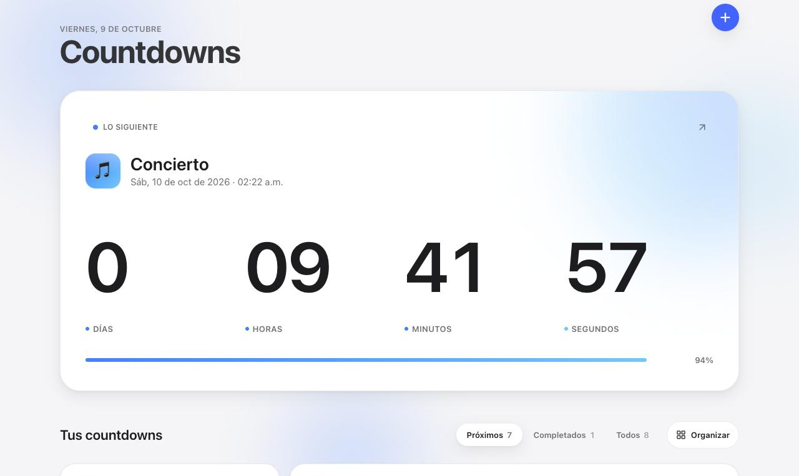<br/><sub>Hero — lo siguiente</sub></td>
<td align="center" width="33%">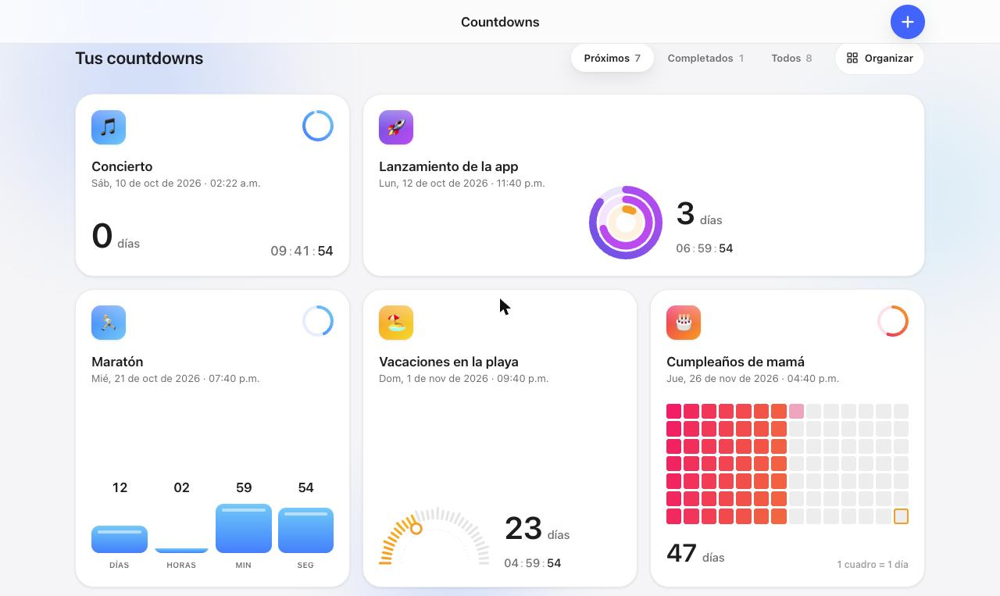<br/><sub>Grid bento con varios estilos</sub></td>
<td align="center" width="33%">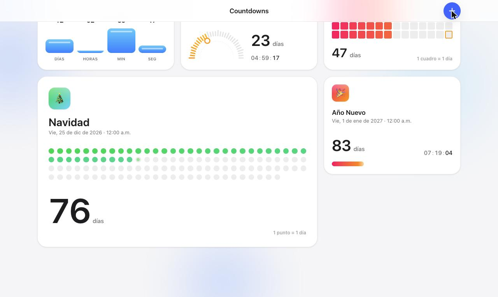<br/><sub>Tarjeta grande (Puntitos)</sub></td>
</tr>
<tr>
<td align="center" width="33%">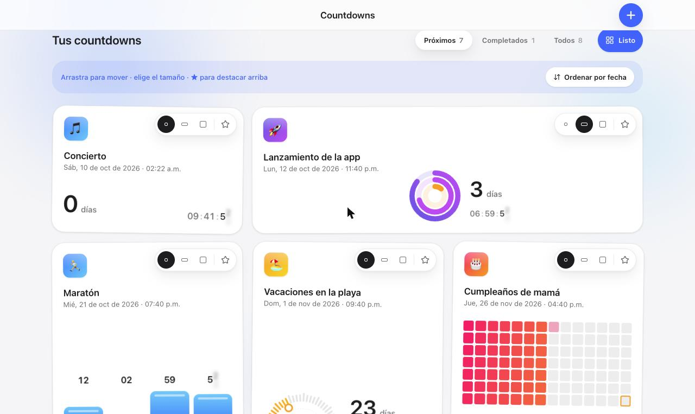<br/><sub>Modo Organizar: tamaño y ★</sub></td>
<td align="center" width="33%">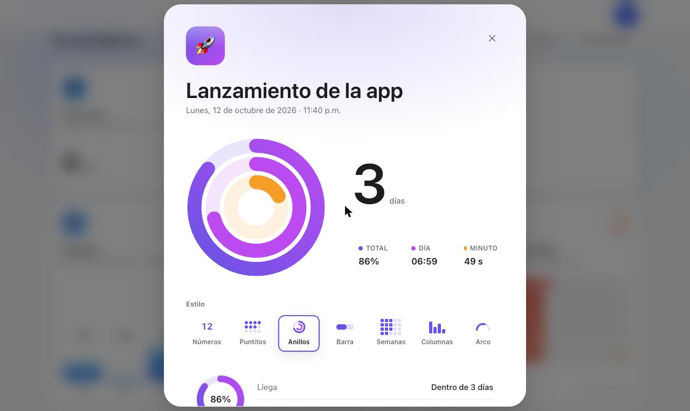<br/><sub>Detalle con selector de estilo</sub></td>
<td align="center" width="33%">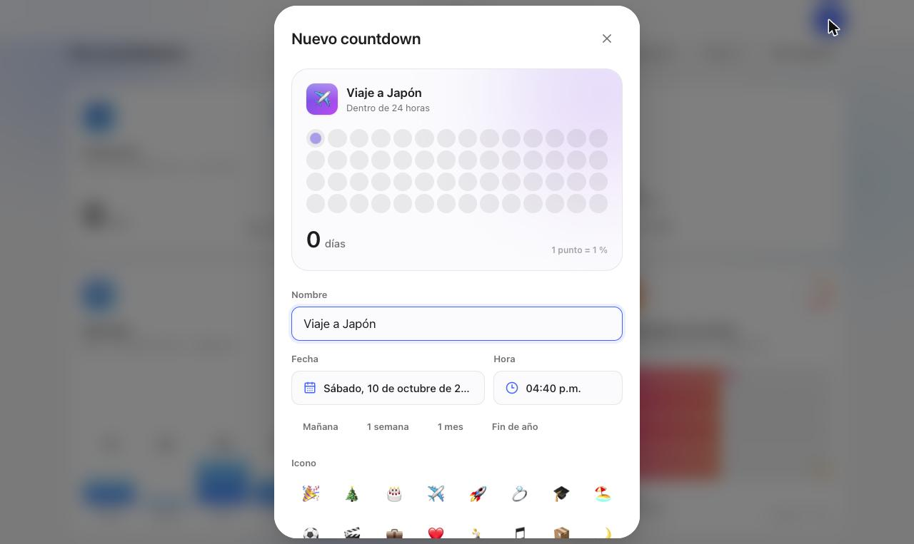<br/><sub>Nuevo countdown con vista previa</sub></td>
</tr>
<tr>
<td align="center" width="33%">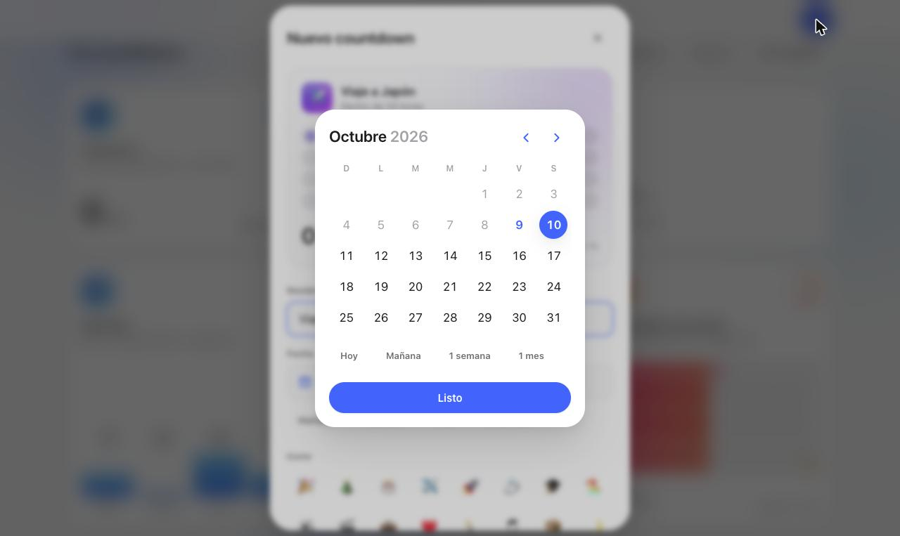<br/><sub>Selector de fecha propio</sub></td>
<td align="center" width="33%">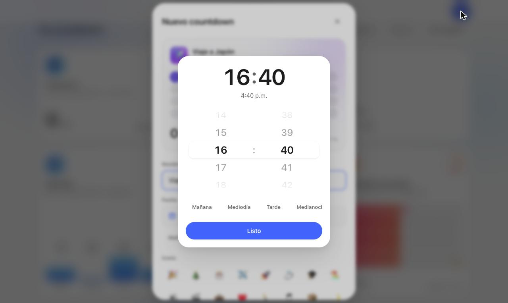<br/><sub>Rueda de hora estilo iOS</sub></td>
<td align="center" width="33%">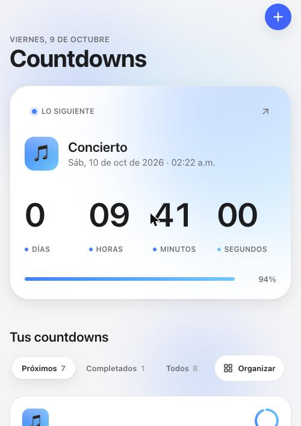 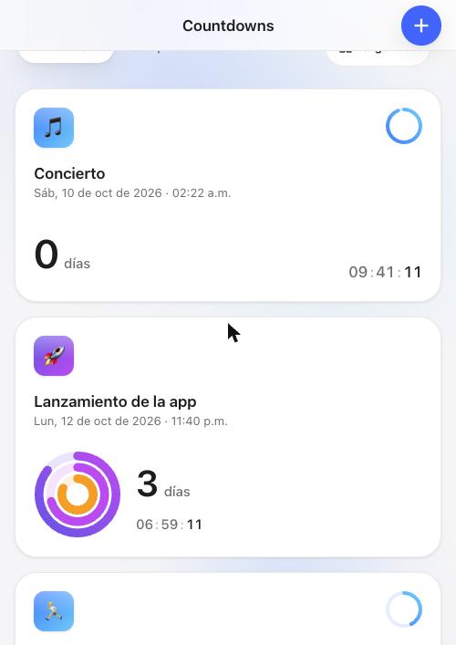<br/><sub>Responsivo en el teléfono</sub></td>
</tr>
</table>
</div>

## 🖥️ Stack técnico

| Capa | Tecnología |
|---|---|
| UI | [React 18](https://react.dev/) + [Vite 6](https://vitejs.dev/) |
| Estilos | [Tailwind CSS 3](https://tailwindcss.com/) con tokens propios (CSS variables) + [tailwind-merge](https://github.com/dcastil/tailwind-merge) |
| Animación | [Framer Motion 11](https://www.framer.com/motion/) — springs, `layoutId`, `AnimatePresence`, motion values |
| Drag & drop | [dnd kit](https://dndkit.com/) (`@dnd-kit/core` + `@dnd-kit/sortable`) |
| Iconografía | [Lucide](https://lucide.dev/) |
| Persistencia | `localStorage` |

**Diseño "Apple-feel"**: tema claro con la paleta del sistema de Apple (`#f5f5f7`, `#1d1d1f`,
azul `#0a6cff`), tipografía SF Pro del sistema con `tabular-nums` en todas las cifras, sombras en
capas, radios anidados, superficies de vidrio con `backdrop-filter`, targets táctiles ≥ 44 px y
`safe-area-inset` para iPhone. Toda la física de movimiento vive en un solo archivo
([`src/lib/motion.js`](src/lib/motion.js)) — springs interrumpibles, nunca curvas lineales — y se
respeta `prefers-reduced-motion`.

## ⚡ Rendimiento

Pensado para ir a 120 fps en pantallas ProMotion, también en el modo Organizar:

- **Un solo reloj como store externo** (`useSyncExternalStore`): solo los dígitos que corren se
  re-renderizan cada segundo; `App`, el Hero y las tarjetas se enteran únicamente cuando un
  countdown cruza el cero. Así los nodos con `layout` de Framer no re-miden el DOM en cada tick.
- **Animaciones infinitas en CSS** (temblor, pulsos, halo): corren en el compositor, no en el hilo
  principal.
- **Cuadrículas memorizadas** (Puntitos, Semanas, Arco) y progreso redondeado a 0.1 %, para no
  reiniciar animaciones por cambios imperceptibles.
- Nada de `backdrop-filter` sobre elementos que se mueven ni de animaciones de `height`.

## 🏗️ Arquitectura

```
Horizonte/
├── index.html
├── tailwind.config.js         # escala tipográfica, radios y colores como tokens
├── screenshots/
└── src/
    ├── App.jsx                # orquesta hero, grid bento, drag & drop, detalle y composer
    ├── index.css              # tokens (CSS variables) y keyframes
    ├── components/
    │   ├── Hero.jsx           # countdown destacado / más próximo
    │   ├── CountdownCard.jsx  # tarjeta: tamaños, tilt 3D, modo organizar, arrastre
    │   ├── Visualizer.jsx     # los 7 estilos de representación
    │   ├── NumericText.jsx    # transición de dígitos tipo iOS
    │   ├── DetailView.jsx     # vista expandida (shared element transition)
    │   ├── Composer.jsx       # crear / editar con vista previa en vivo
    │   ├── pickers/           # calendario y rueda de hora propios
    │   └── …                  # Header, StylePicker, Toast, Celebration, ProgressRing…
    └── lib/
        ├── motion.js          # fuente única de springs y duraciones
        ├── store.js           # countdowns, orden, tamaños y destacado (localStorage)
        ├── time.js            # cálculos y formato de fechas (es-MX)
        ├── useNow.jsx         # un solo reloj alineado al segundo para toda la app
        └── …                  # temas de color, estilos, origen de modales
```

## 🚀 Cómo levantarlo

### Requisitos

- [Node.js](https://nodejs.org/) 18 o superior

### Local

```bash
git clone https://github.com/JoseLuis0022/Horizonte.git
cd Horizonte
npm install
npm run dev
```

Abre <http://localhost:5173>.

### Build de producción

```bash
npm run build     # genera dist/
npm run preview   # sirve el build localmente
```

`dist/` es un sitio 100 % estático: se puede publicar tal cual en Cloudflare Pages, Vercel,
Netlify o GitHub Pages.

## ⌨️ Atajos

| Tecla | Acción |
|---|---|
| `N` | Nuevo countdown |
| `Esc` | Cerrar la ventana abierta / salir del modo Organizar |
| `Enter` | Guardar en la ventana de crear / editar |

## 📄 Licencia

[MIT](LICENSE) © 2026 José Luis Macedo
